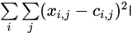

# Stage 4/6: Find that K
## Description
Congratulations! Now you have a working K-Means algorithm. However, simply implementing the algorithm is not enough,  
as it does require us to tune a major hyperparameter: `k`.

There are several methods how one could find an appropriate value for it. We would cover two methods: **the elbow rule**  
and determining **the silhouette score**. Let us start with the elbow rule.

In order to use it, we need to calculate the sum of squares of distances from each of the items to the centroids,  
i.e. calculate

 Here **xi** is the **i-th** item, **ci** is the center of the cluster we assigned **xi** to.  
**j** enumerates the features. In fact, we ask you to calculate the sum of squares of Euclidean distances from each item  
to its assigned cluster center. This value is called "inertia" in
[scikit-learn implementation](https://scikit-learn.org/stable/modules/generated/sklearn.cluster.KMeans.html), for example.

We would run your coded algorithm with different `k` values ranging from **2** to **10**. Our goal is to find which `k` value is  
the most accurate. To determine this, we examine the inertia values obtained for different `k` values. Look for the point  
where the inertia's rate of decrease significantly slows down, creating a noticeable bend or "elbow" shape in the plot.  
This elbow point indicates the optimal number of clusters.

## Objectives
1. Use the custom K-Means class with `k` ranging from **2** to **10** (both included) and calculate the inertia for each `k`.
2. Print the results for the "error" for each of the `k` values.
3. To find the desired `k`, plot the dependence of the inertia from `k` and look for the "elbow".

## Example
### Example 1: an example of the output

```
[12, 8, 7, 6, 5, 4, 3, 2, 1]
```